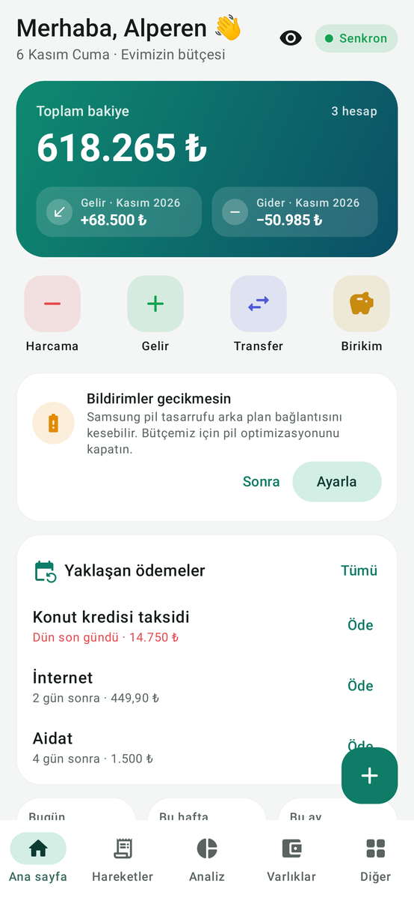
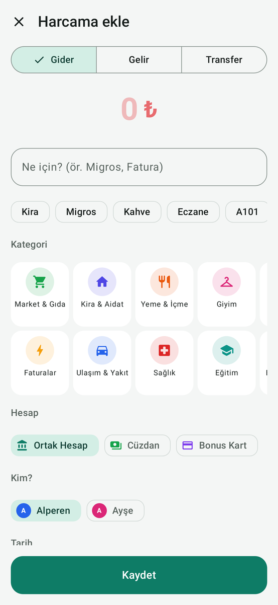
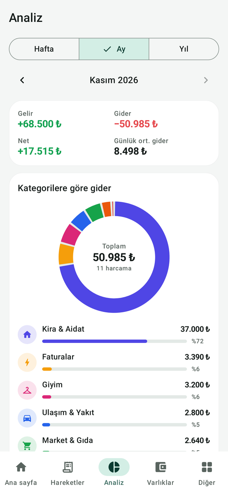
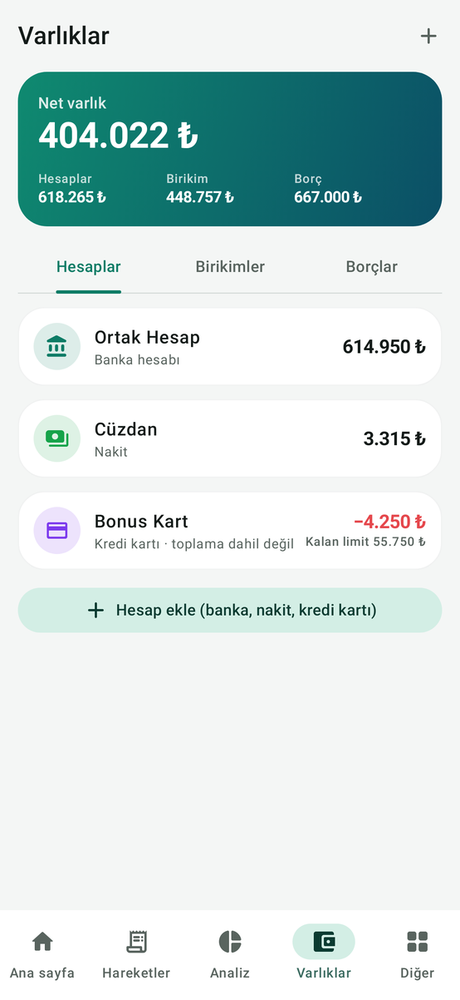
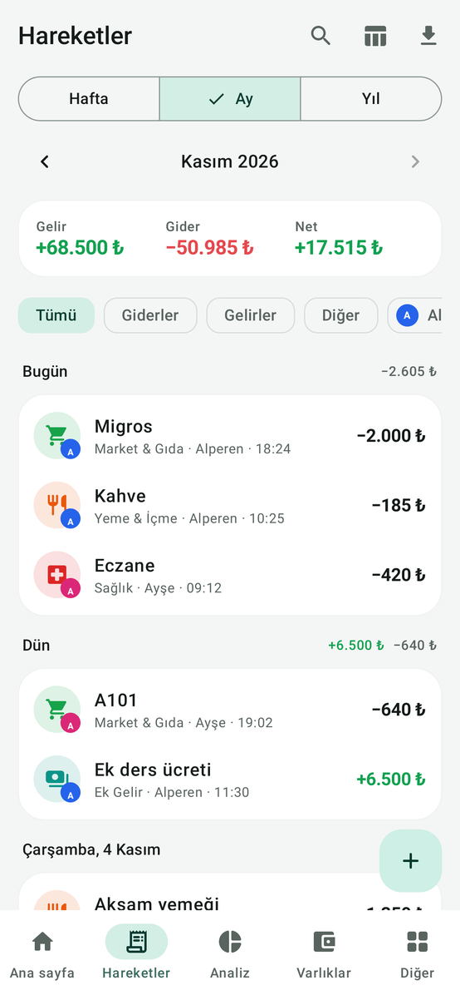
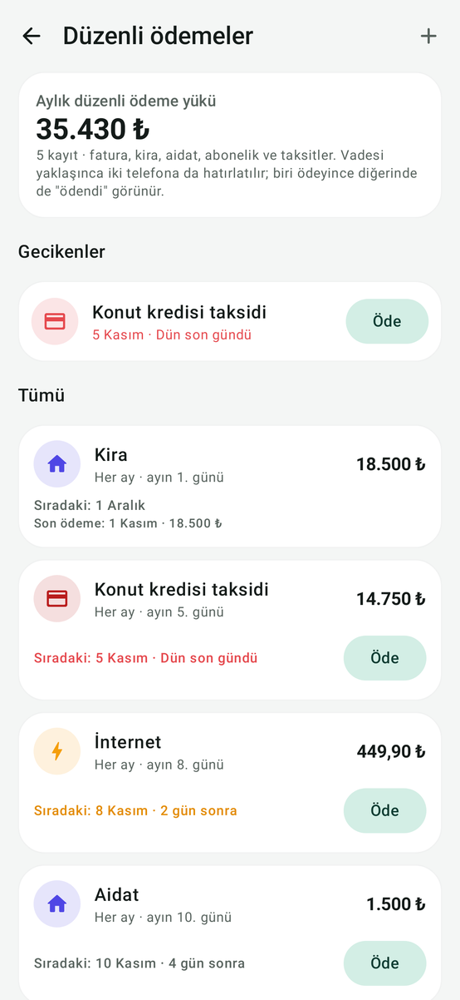
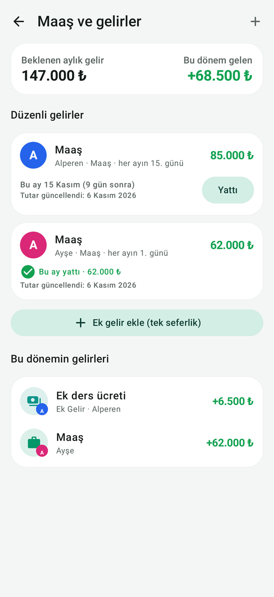
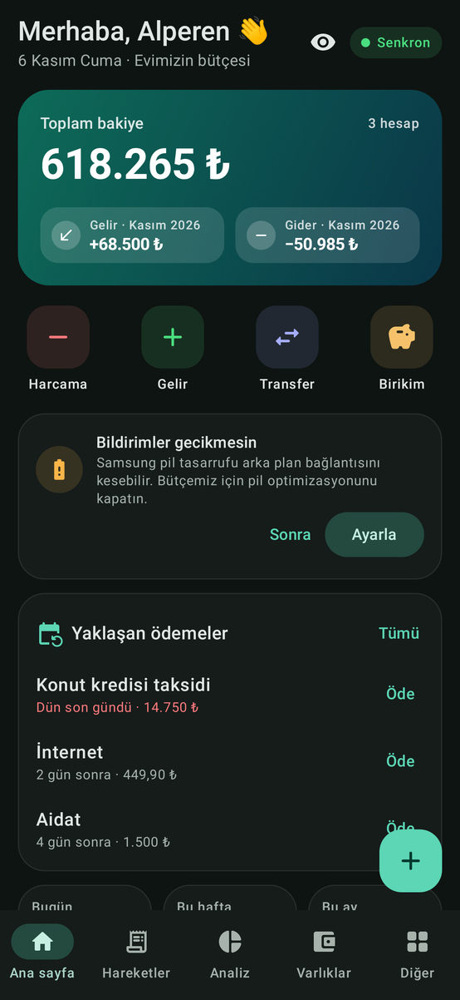

# Bütçemiz — Eşinizle ortak ev bütçesi (Android)

Evinizin ekonomisini eşinizle birlikte, **iki telefonda anlık** olarak yönetmek için yapılmış bir Android uygulaması.
Biriniz harcama girdiğinde diğerinin telefonuna saniyeler içinde bildirim gelir:

> **Alperen harcama yaptı · −2.000 ₺**
> Migros · Market & Gıda için — Yeni bakiye: 118.000 ₺

Hesap açmak, reklam ya da abonelik yok. Veriler telefonlarınızda durur, aralarında **uçtan uca şifreli** taşınır.

| Ana sayfa | Harcama ekle | Analiz | Varlıklar |
|---|---|---|---|
|  |  |  |  |
| **Hareketler (tablo/liste)** | **Düzenli ödemeler** | **Maaş ve gelirler** | **Koyu tema** |
|  |  |  |  |

---

## İndir ve kur

**APK:** [`release/Butcemiz-v1.0.0.apk`](release/Butcemiz-v1.0.0.apk) (4,4 MB · Android 8.0 ve üzeri · S23 FE / S24 FE uyumlu)
SHA-256: `a1bd6bafd8a5aaa7dabdc42c95fd89028584ac68d6d1aeb2dfdc2d3dc92681b0`

1. APK dosyasını telefona indirin (GitHub'da dosyaya dokunup **Download / İndir**, ya da bilgisayardan USB ile kopyalayın).
2. **Dosyalarım → İndirilenler → Butcemiz-v1.0.0.apk**'ya dokunun.
3. "Bilinmeyen uygulamalar" uyarısı çıkarsa: **Ayarlar**'a dokunun → **Bu kaynaktan izin ver**'i açın → geri dönüp **Yükle**.
   (Samsung'da yol: *Ayarlar → Güvenlik ve gizlilik → Diğer güvenlik ayarları → Bilinmeyen uygulamaları yükle*.)
4. Google Play Protect "uygulama taranmadı" derse **Yine de yükle** deyin (uygulama Play Store'da olmadığı için normaldir).
   Samsung **Otomatik Engelleyici** açıksa yüklemeye izin vermez: *Ayarlar → Güvenlik ve gizlilik → Otomatik Engelleyici*'yi kurulum için kapatın, sonra isterseniz tekrar açın.
5. Aynı adımları **ikinci telefonda** da yapın.

## İlk kurulum (iki telefon, 2 dakika)

**1. telefon (ör. S23 FE)**
1. **Yeni ortak bütçe oluştur**'a dokunun.
2. Adınızı, eşinizin adını, şu anki toplam paranızı (ör. 120.000) ve isterseniz maaşınızı/maaş gününüzü girin.
3. **Bütçeyi oluştur** → ekranda bir **QR kod** açılır.

**2. telefon (ör. S24 FE)**
1. **Eşimin bütçesine katıl → QR okut** ile 1. telefondaki kodu okutun
   (ya da 1. telefondan **Paylaş** ile kodu WhatsApp'tan gönderip **Kodu yapıştır** deyin).
2. Veriler birkaç saniyede gelir; **"Siz hangisiniz?"** ekranında kendinizi seçin. Bitti 🎉

Her iki telefonda da **bildirim iznini** verin ve ana sayfadaki **"Bildirimler gecikmesin" → Ayarla** ile pil optimizasyonunu kapatın.

## Neler yapabilirsiniz?

- **Anlık senkron ve bildirim:** Harcama, gelir, transfer, düzenleme ve silmeler iki telefonda anında görünür; eşinizin her girişinde "yeni bakiye" bildirimi gelir. Uygulama açıksa ana sayfada şerit olarak görünür ve akışta vurgulanır.
- **Mevcut para / hesaplar:** Ortak hesap, banka, nakit (cüzdan), kredi kartı (limit takibi). Toplam bakiye her hareketle kendiliğinden güncellenir; "Bakiyeyi düzelt" ile bankadaki gerçek tutara eşitlenir.
- **Harcama ekleme:** Tutar, ad ("Ne için?"), kategori, hesap, kişi, tarih, not. Daha önce yazdıklarınız öneri olarak çıkar ve kategoriyi kendisi seçer.
- **Maaş ve ek gelirler:** Maaş tutarı ve yatma günü; zam gelince tutarı güncelleyin. Maaş günü bildirim gelir, **Yattı** deyince bakiyeye eklenir. Ek gelirler tek dokunuşla.
- **Birikimler ve türleri:** Gram/çeyrek/yarım/tam/Cumhuriyet/Ata/Reşat altın, 22-18-14 ayar, gümüş, dolar, euro, sterlin, frank, vadeli mevduat, BES, fon, hisse, kripto. **Güncel kurlarla TL karşılığı** (Truncgil + TCMB), kâr/zarar ve hedef ilerlemesi. "Ekle / Çıkar-Sat" ile bakiyeden düşebilir/ekleyebilirsiniz.
- **Borçlar ve alacaklar:** Kredi, kredi kartı borcu, taksitler, şahıs borcu. Ödedikçe kalan tutar düşer; taksitleri "Düzenli ödemeler"e ekleyip her ay hatırlatma alabilirsiniz.
- **Ödemeler (fatura, kira, aidat, abonelik):** Vadesi yaklaşınca hatırlatma, bildirimden **"Ödendi olarak işaretle"**. Aynı faturayı ikiniz aynı anda ödemeye bassanız bile tek kayıt oluşur.
- **Harcama tabloları ve analiz:** Haftalık / aylık / yıllık dönemler, liste veya **tablo** görünümü, arama ve filtreler (tür, kişi, kategori); kategori halka grafiği, günlük çubuklar, **haftalık giderler**, "kim ne kadar harcadı", son 6 ay gelir-gider trendi, en büyük harcamalar, birikim oranı.
- **Bütçe limitleri:** Aylık toplam ve kategori bazında; %80 ve %100'de iki telefona uyarı.
- **Excel'e aktarma (CSV)**, tam **JSON yedek / geri yükleme**.
- **Ana ekran widget'ı** (bakiye + hızlı harcama/gelir), uygulama simgesine basılı tutunca **"Harcama ekle"** kısayolu.
- **Uygulama kilidi** (parmak izi/yüz/ekran kilidi), **tutarları gizle**, ekran görüntüsü engelleme, açık/koyu tema.
- **Bütçe dönemi:** Maaşınız 15'inde yatıyorsa ayı 15'inden başlatabilirsiniz (Ayarlar → Bütçe adı ve dönemi).

## Senkronizasyon nasıl çalışır? (gizlilik)

- Her değişiklik telefonda bir **işlem günlüğüne** yazılır ve **AES-256-GCM** ile şifrelenip ücretsiz aktarıcı **ntfy.sh** üzerinden diğer telefona iletilir. Şifre anahtarı yalnızca QR kodla paylaştığınız iki telefonda bulunur; aktarıcı yalnızca anlamsız şifreli metin görür ve en çok 12 saat tutar.
- İnternet yoksa değişiklikler bekletilir, bağlantı gelince otomatik gönderilir. Bir telefon uzun süre kapalı kalırsa, açıldığında eksiklerini diğer telefondan ister.
- Aynı kaydı ikiniz aynı anda düzenlerseniz en son yapılan geçerli olur; **bakiyeler hareketlerin toplamından hesaplandığı için para kaybı ya da çift sayım olmaz.**
- ntfy.sh ücretsiz kullanımda IP başına günde 250 mesaj verir; normal bir aile kullanımında günde 20–50 mesaj harcanır. (Kota dolarsa ana sayfadaki rozet "Sınırda" olur, değişiklikler kaybolmaz, kota açılınca gönderilir. İsterseniz *Aile & eşleştirme → Gelişmiş* bölümünden kendi ntfy sunucunuzu girebilirsiniz.)

## Sık sorulanlar

- **Eşimin harcaması bildirim olarak gelmiyor:** Bildirim izni açık mı? *Aile & eşleştirme → Arka planda bağlı kal* açık mı? Samsung'da *Ayarlar → Pil → Arka plan kullanım sınırları → Hiç uyutulmayan uygulamalar*'a Bütçemiz'i ekleyin.
- **Telefonu değiştirdim / sıfırladım:** Yeni telefonda **Eşimin bütçesine katıl** deyip diğer telefondaki QR'ı okutun; tüm veriler geri gelir.
- **Yanlışlıkla iki telefonda da "yeni bütçe" oluşturduk:** Telefonlardan birinde *Diğer → Aile & eşleştirme → Başka bir bütçeye katıl* ile diğerinin kodunu okutun; veriler birleşir (fazla üye varsa *Aile üyeleri*'nden silebilirsiniz).
- **Bankadaki para uygulamadakinden farklı:** Hesaba dokunun → **Bakiyeyi gerçek tutara eşitle**.

## Güncelleme ve imza anahtarı

APK, `keystore/butcemiz-release.p12` anahtarıyla imzalanmıştır. **Bu anahtar güvenlik nedeniyle depoda yoktur**; sahibine ayrıca verilmiştir.
Yeni sürümlerin eskisinin **üzerine (veriler silinmeden)** kurulabilmesi için aynı anahtarla imzalanması gerekir:

```properties
# butcemiz-android/keystore.properties  (git'e EKLENMEZ)
storeFile=keystore/butcemiz-release.p12
storePassword=<parola>
keyAlias=butcemiz
keyPassword=<parola>
```

## Derleme (geliştiriciler için)

Gereksinimler: JDK 17+ (21 ile test edildi), Android SDK (platform 36). Gradle sarmalayıcısı dahildir.

```bash
cd butcemiz-android
./gradlew testDebugUnitTest      # birim + senkron entegrasyon + ekran görüntüsü testleri
./gradlew assembleRelease        # imzalı APK: app/build/outputs/apk/release/
```

**Mimari:** Kotlin · Jetpack Compose (Material 3) · Room · kotlinx.serialization · OkHttp · WorkManager · ön plan servisi (specialUse) · Glance widget · ZXing (QR üretimi) · Google kod tarayıcı (QR okuma) · AndroidX Biometric.
Senkron: cihaz başına sıralı işlem günlüğü (op-log) + hibrit mantıksal saat (HLC) + kayıt bazında "son yazan kazanır" + durum vektörüyle eksik tamamlama; bakiyeler toplanabilir hareketlerden türetilir. Testler: para/biçim, dönem ve hesaplama, şifreleme ve davet kodu, kur ayrıştırma, ntfy HTTP katmanı, iki sanal telefonla uçtan uca senkron (eşleşme, eşzamanlı düzenleme, çift ödeme engeli, kısa ve 12 saati aşan kopukluk) ve Robolectric ekran görüntüleri.
